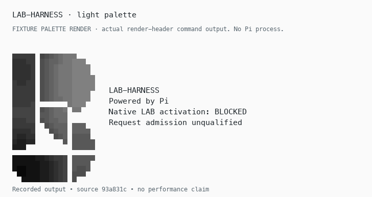
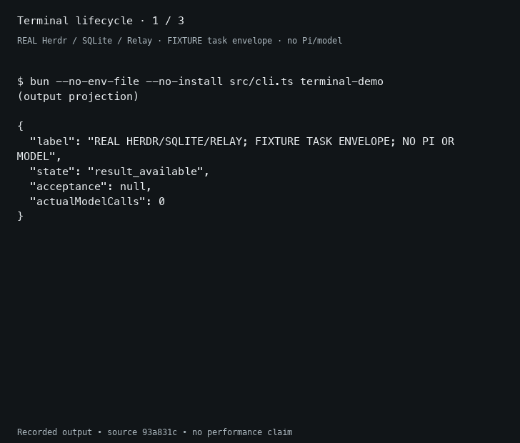
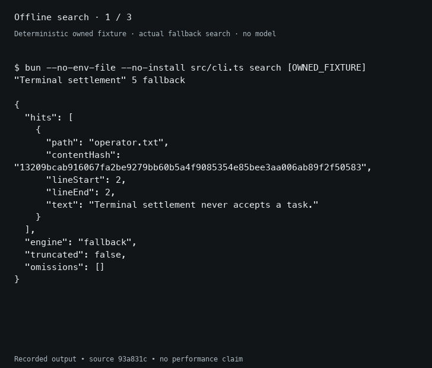
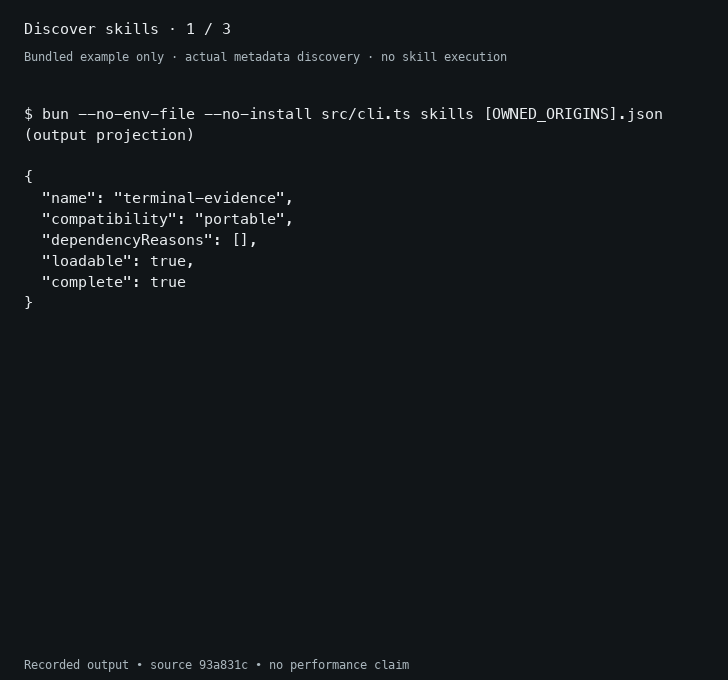

<picture>
  <source media="(prefers-color-scheme: dark)" srcset="assets/branding/terminal-b-dark.svg">
  
</picture>

# LAB-HARNESS

An offline terminal harness with real owned Herdr processes, durable SQLite task
state, pinned Relay mailboxes, source-bound context and explicit operator
acceptance. Search and skill discovery work without a model or connected service.

The first integration slice runs a harmless terminal worker and retains its
actual process evidence. Its coordinator task envelope remains explicitly
fixture-only. **Native Pi task admission is blocked; WSL is unverified.**
Pi UI branding and advisory events do not qualify native task execution.

## Screens and recorded walkthroughs


Actual captured Pi 1.4.0 startup text, rendered for readability. Herdr's pane API
omits colors, so this is a text reconstruction rather than a raw pixel screenshot.
No prompt was submitted and native LAB stays blocked.
[Full transcript](docs/media/pi-startup.txt) · [Full-size image](docs/media/pi-startup-text.png).

<picture>
  <source media="(prefers-color-scheme: dark)" srcset="docs/media/header-dark.png">
  
</picture>

The light/dark image above is a **palette fixture** from the actual header-render
command, separate from the Pi startup observation.

The GIFs below replay selected **actual command outputs** on disposable fixtures.
Each is an output-slide replay, not continuous terminal video: three six-second
scenes, with no simulated typing. Display pacing is edited and says nothing about
execution speed. No skill or model executes. Full text remains available on mobile.

**Terminal lifecycle:** a real Herdr worker settles; the ledger waits at
`result_available` until a separate test-operator command accepts the evidence.
The task envelope is explicitly fixture-only.



[Terminal transcript](docs/media/terminal-lifecycle.txt) · [Full-size GIF](docs/media/terminal-lifecycle.gif).

**Source search:** literal query, source path/line/byte hash, then refusal after
an edit to the disposable source.



[Search transcript](docs/media/offline-search.txt) · [Full-size GIF](docs/media/offline-search.gif).

**Skills:** metadata discovery, sealed selection and compatibility/dependency
inspection from the committed sanitized inventory. No user skill body is shown.



[Skills transcript](docs/media/skills-discovery.txt) · [Full-size GIF](docs/media/skills-discovery.gif). Capture commands, sanitization,
renderer details and evidence boundaries are in [the media guide](docs/demos/README.md)
and [the asset manifest](docs/media/PROVENANCE.json).

## Run it

Prerequisites: Git and **Bun 1.4.2**. The first install needs the public npm
registry; explicit Herdr acquisition needs GitHub. No account, credential,
inference service or model download is required. No global installation occurs.

```sh
git clone https://github.com/bbawuah/lab-harness.git
cd lab-harness
bun --version
bun --no-env-file install --frozen-lockfile --ignore-scripts
bun --no-env-file run check
bun --no-env-file run setup:herdr
bun --no-env-file run demo:terminal
bun --no-env-file run check:actual
```

Herdr acquisition verifies an official release asset's SHA-256 and caches it in
`.tmp/herdr`. Subsequent terminal runs use that local cache and do not download.
The runtime is v0.9.5, release commit `2ecf19a92fc3a7fff75b6ce3655ef04f4625ec01`,
**different from** the inspected source pin
`bc8c28988f75c538d4ca058b702f5adbea30566e`. Both identities are recorded in
[the Herdr manifest](contracts/herdr-source.json). No binary is committed.

`demo:terminal` searches an owned source file, builds and revalidates immutable
context, launches a harmless worker in an isolated Herdr session, observes its
output and process status, then stops its pane/server. Results travel through
persisted outgoing intents and real Relay ingest-before-ack. The ledger finishes
at `result_available` with acceptance `null`. It prints the owned state directory
and review commands; inspect them before explicitly invoking `accept`.

The original `bun --no-env-file run demo` is still a deterministic **fixture**
gateway/worker/candidate demo. It makes no model calls and simulates an explicit
operator disposition. Actual process evidence and fixture envelopes stay labelled.

## Operator commands

Prefix these with `bun --no-env-file --no-install src/cli.ts`. State and search
roots must be owned subdirectories inside this clone; this is a bounded source
adapter, not an OS sandbox or same-user authentication boundary.

```text
terminal-demo                   # real Herdr/SQLite/Relay, no model, acceptance pending
herdr-smoke                     # process evidence only; no task authority
header [COLUMNS] [light|dark] [--no-color]
pi-ui-smoke PI_PATH NODE_PATH    # owned no-model Pi startup through Herdr, then stop
search ROOT QUERY [LIMIT] [auto|fallback|rg]
files ROOT NAME [LIMIT]          # literal basename substring
context ROOT INPUT.json         # candidate, requirements, sources, optional selected skills
verify-context ROOT CONTEXT.json
skill ROOT RELATIVE/SKILL.md     # original progressive metadata helper
skills ORIGINS.json             # sanitized inventory; roots are explicit local inputs
skill-select ORIGINS.json NAME  # sealed identity; ambiguous names are refused
skill-load ORIGINS.json REF.json # explicitly returns verified instruction text
--state PATH create INPUT.json  # {contract, context, workspaceRoot?}
--state PATH show TASK
--state PATH claim TASK SESSION
--state PATH event CALLBACK.json
--state PATH accept REVIEW.json # trusted operator workflow only
--state PATH cancel TASK
--state PATH recover
admission
activate-pi                     # refuses NATIVE_PI_UNQUALIFIED
```

Search preserves complete source-byte hashes, relative paths and one-based line
spans. It excludes sensitive config/env paths, generated state, binaries, invalid
UTF-8, symlinks and hardlinked files. Limits and omissions are explicit. Context
rehydrates selected lines and refuses changed, deleted or renamed sources.
[Search behavior and benchmark](docs/search.md), [context/architecture](docs/architecture.md).

The deterministic 266-file code/docs benchmark exercises actual Bun SQLite FTS5.
Exact search Recall@5 was 1.0 versus FTS5 0.9 across ten fixture queries; token
semantics differ and full index reconciliation was not measured. Exact scanning
remains the default. Optional rg is a bounded prefilter; no hybrid, vector or
graph benefit is claimed. Rerun with `bun --no-env-file run benchmark:search`.

## Skills and Pi

[The skill compatibility report](docs/skills.md) inventories all discovered user
and portable-repository origins, retaining duplicates, resource/script identities
and unavailable dependencies. Metadata discovery executes no skill code. Explicit
local loading rechecks the instruction and complete resource bundle. Private
bodies, home paths and proprietary bundles are not published. Source roots are
operator-supplied local manifests; connected services remain connected-service
dependencies. Skill text is not a security boundary.

Prefix context or state commands with `--skill-sources ORIGINS.json` when their
context contains selected skills. Creation, claim, event and acceptance recheck
both source bytes and every selected skill bundle. Missing manifests and changed
scripts/resources refuse the operation. Cancellation and inspection stay usable
for recovery. The terminal demo writes its own local example manifest and prints
the complete operator command; no user skill executes automatically.

The opt-in Pi advisory bridge maps native TUI prompts to Herdr's blocked events
and retains aborted/model-selection observations. It grants no acceptance or
request-admission authority. The [Pi seam report](docs/pi-seam.md) identifies
swallowed hook exceptions, compaction/retry paths, auth-dependent routing and
cache warming as reasons native activation remains blocked. LiteLLM remains an
existing client destination; this project deploys no gateway or inference backend.

The owner's terminal B uses the canonical six paths and four-spot mesh in neutral
monochrome. [Light](assets/branding/terminal-b-light.svg) and
[dark](assets/branding/terminal-b-dark.svg) SVGs have no private runtime dependency.
[Brand preview](docs/branding-preview.html) and
[provenance](assets/branding/PROVENANCE.json) retain the source identity.

The [supported Pi header extension](src/pi/header.ts) replaces Pi's built-in
startup logo and hints through `ctx.ui.setHeader`, while retaining **Powered by
Pi** and the blocked native-LAB status. Its terminal mesh derives from those
exact SVGs; narrow/no-color terminals get an identified `[B]` text fallback.
`pi-ui-smoke` launches the explicitly supplied installed Pi 1.4.0 with offline,
no-tool/no-MCP/no-discovery flags in an owned Herdr pane, checks the visible
header and stops it. It submits no prompt and never activates LAB. This worked
on macOS with the actual installed Pi; [runtime identity and evidence limits](docs/pi-header.md)
remain separate from fixture palette checks. No Pi installation is required by
the default checks or CI, and nothing is installed globally.

## Validation and limits

`check` runs regressions, strict typecheck and publication integrity. Actual Herdr
and integrated-flow tests are explicit skips without `LAB_HERDR_ACTUAL=1`;
`check:actual` requires the acquired runtime and fails if it is unavailable.
GitHub CI runs actual terminal checks, demos and the deterministic benchmark on
Linux and macOS. Ubuntu evidence applies to that runner, **not WSL**.

Owned normal/deadline cleanup is exercised. Parent termination, SIGKILL, machine
loss, arbitrary descendants, offline packet capture and WSL remain unqualified.
Native Pi cancellation/admission/model binding is also unqualified. Existing
ledger schema v1 and initialization-crash limits remain; use a new owned state
directory, not an old concept database. Recovery retires uncertain claims;
terminal restarts never accept a task. Detailed same-user coordination limits
are in [the architecture](docs/architecture.md) and [Herdr notes](docs/herdr.md).

## Publication and rights

The original exported concept's hashes remain immutable in
[the source manifest](docs/source-manifest.json). Development files have separate
current identities and an exact allowlist. The checker also rejects private
paths/credential patterns and preserves all nine unchanged Relay source hashes
at `dfe1b039bab45f4055ab39467e994a2981940c02`. Generated `.git`, `.tmp` and
`node_modules` entries are excluded. Inspect intentional changes before running
`bun --no-env-file run refresh:publication`; CI never refreshes hashes.

[NOTICE.md](NOTICE.md) records attribution and rights. This repository grants no
reuse license; `private: true` also prevents package-registry publication. No
private source history, vault contents, tokens, model assets or third-party skill
bundles are committed. The current [build plan](docs/build-plan.md) is separate
from immutable historical research inputs.
