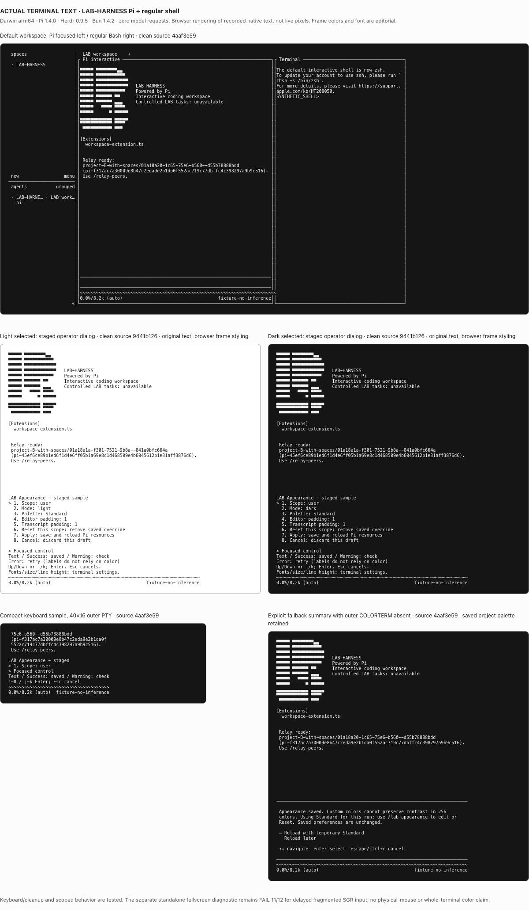
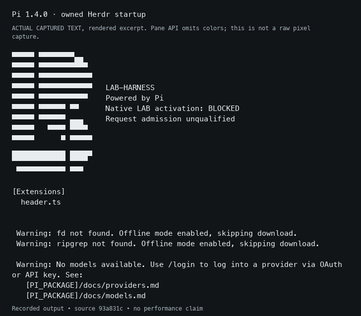

<picture>
  <source media="(prefers-color-scheme: dark)" srcset="assets/branding/terminal-b-dark.svg">
  
</picture>

# LAB-HARNESS

LAB-HARNESS is an AI coding workspace for your terminal and the project you are
in. Pi provides the conversation and coding tools, Herdr runs the interactive
terminal, and LAB adds source search, explicit skill loading and built-in Relay
mail between workspace sessions. Connect a local
model server (on this machine, LAN or tailnet) or your existing LiteLLM endpoint.

**[User guide: five-minute start and command reference](docs/user-guide.md)**.
Inside the workspace, use /lab-help. Pi opens on the left and your regular
interactive shell on the right; use Ctrl+B then h/l to change focus.
For a narrow terminal, use `lab --single-pane`.

## Install and start

Run this from your project folder **or your home folder**. You do not need a LAB-HARNESS checkout,
Git, Bun, Node or Pi already installed:

```sh
curl -fsSL https://raw.githubusercontent.com/bbawuah/lab-harness/main/bootstrap.sh | sh
```

The command installs the harness in your user directory, then opens setup and
the LAB TUI in your current project. From home (or a folder containing LAB's
installation/state), it first asks you to select an existing project folder,
such as `~/Projects/my-app`. Enter the path without shell quotes; spaces work.
Blank input, Ctrl-C or Ctrl-D cancels. LAB never selects home for source search.
Model setup then asks for:

1. `local` for a local/self-hosted OpenAI-compatible server, or `litellm` for
   your existing LiteLLM endpoint. Self-hosted URLs may be on any HTTP(S) host,
   including LAN and tailnet addresses.
2. The existing OpenAI-compatible base URL, including `/v1` when required.
3. The exact local model ID or existing LiteLLM alias, then its API key.
   Key input is hidden; leave it blank for an unauthenticated local server.

Pi may also ask whether you trust the selected project folder. Review that native
prompt and make your choice; LAB does not bypass it.

**You provide the model endpoint.** Start your local model server separately,
or use an existing LiteLLM service. Installation does not deploy LiteLLM, download
model weights, send a model prompt or choose a paid model. Once the TUI opens,
type a prompt. Use `/exit` to leave.

Supported: **macOS arm64/Intel and Linux x86_64**; WSL is not yet verified.
Standard `curl`, `tar`, `unzip` and SHA-256 utilities are needed. First install
needs GitHub/npm access to acquire verified Pi 1.4.0, Herdr 0.9.5, ripgrep,
fd and Bun 1.4.2 when missing. No sudo or shell profile changes are made.
Without an interactive terminal, the command installs only and prints the
launcher. Explicit install-only mode is `| sh -s -- --install-only`.

## Start again in your project

Installation creates a guarded ~/.local/bin/lab command. If the installer
verifies it on PATH (or after you run its printed PATH step), start from your
project with:

~~~sh
lab
lab --help
~~~

The installer preserves foreign lab commands and edits no shell profiles.
If PATH is not ready or a command collision exists, use this exact fallback:

```sh
"${XDG_DATA_HOME:-$HOME/.local/share}/lab-harness/lab"
```

Or select an existing project explicitly, including paths with spaces:

```sh
"${XDG_DATA_HOME:-$HOME/.local/share}/lab-harness/lab" --project "/path/to/my project"
```

Use `/lab-appearance` to preview light/dark/terminal themes, semantic colors
and spacing, then Apply, Cancel or Reset. Fonts remain terminal settings.

The TUI shows the selected project. Pi's working directory, LAB source search
and project skills all use that folder. The installed harness and private model
settings stay separate. Sessions are stored by project; normal startup creates
a new session, with previous ones available through Pi's session controls.

For an existing LAB-HARNESS clone, the equivalent setup and start are:

```sh
cd lab-harness
./install.sh
./lab --project "/path/to/my project"
```

You can also invoke that clone's absolute `lab` path from another project.
Bare `lab` requires an explicit PATH addition; setup prints the optional command.
For the current shell only:

```sh
export PATH="$HOME/.local/bin:$PATH"
command -v lab
```

## Try it

Type a simple first prompt:

```text
Reply with exactly READY as plain text. Do not call tools.
```

Then try the LAB commands:

```text
/lab-search TODO
/lab-files README
/lab-skills
/relay-peers
```

Search returns matching project files, lines and byte hashes. The model also
has `lab_search` and `lab_files` tools. `/lab-skills` lists project, bundled and
local user skills without loading or running them. To load the bundled example,
replace `ID` with its displayed `terminal-evidence` ID:

```text
/lab-skill ID examples terminal-evidence/SKILL.md
```

Other skills can use `/lab-skill ID` when their source is unambiguous. Loading
rechecks instruction/resource identities and does not run scripts. Native Pi
provides the usual file and shell coding tools.

Relay is ready automatically in each native session. Open another lab terminal
on the same project, use /relay-peers, then
/relay-send PEER REQUEST_KEY MESSAGE and /relay-inbox. Reading never acknowledges;
/relay-ack MESSAGE_ID is explicit. Tool-capable models receive the same
relay_peers/send/inbox/ack tools; operator commands provide a fallback. Messages
do not wake models or accept tasks. [Two-session workflow](docs/user-guide.md#message-another-workspace-session).

This is a **native Pi coding workspace**. Controlled LAB ledger-task execution
remains unavailable; terminal output never accepts a LAB task. Native shell and
file tools run as your user, so project binding is not an OS sandbox. Details
and the unqualified request-admission boundary are explained below.

[Actual current terminal/model evidence](docs/interactive-validation.md) records
what was tested, including the small local model's tool-use limits. Historical
screenshots below are separate observations.

## Terminal workspace

Pi starts beside your regular shell. Use `/lab-appearance` for staged appearance
controls and `lab --single-pane` in a narrow terminal.



This is a browser rendering of actual native terminal text, not live pixels;
frame colors/fonts are editorial. [Source-labelled captures and limits](docs/evidence/tui/README.md)
distinguish clean 944 and 4aaf runs. The separate delayed mouse-fragment diagnostic
remains unqualified.

## Settings, caches and updates

Use the same launcher with `--configure` to change endpoint/model/key, or with
`--offline` to require complete local runtime caches. `./install.sh --offline`
also requires the frozen JavaScript package cache. A healthy launch reads the
verified runtime and keeps working/session state outside the installation and
project. Missing/corrupt dependencies need repair; offline repair fails clearly
when bytes are unavailable.

Releases live under
`${XDG_DATA_HOME:-$HOME/.local/share}/lab-harness/releases/<commit>`. Private
route, key, sessions and owned terminal state stay under
`$HOME/.local/share/lab-harness/workspace`, including when releases use external
`XDG_DATA_HOME`. Keys are private file contents, not command arguments.

Rerun the public install command to verify/reuse the pinned release and update
the LAB-owned launcher. Source archives and runtime artifacts have fixed hashes.
Modified release source and unrecognized existing launchers are refused rather
than overwritten. Old releases and user state are retained.

If startup asks for a project, choose an existing code folder outside LAB's
release and private-state folders. Home itself cannot be the workspace. You
can also `cd` into your project and run the launcher, or use `--project DIR`.
Without a TTY, bootstrap installs only; open the printed launcher in a terminal
to select the project and configure a model.

## Secondary demonstrations and developer checks

These commands demonstrate task/search/terminal contracts; they do not start the
AI workspace. `demo:terminal` uses a harmless real Herdr worker; `demo` uses
fixture workers. Developer checks require the source Git checkout.



This historical image captures startup text at source commit `93a831c4`, before
the interactive workspace. It is a text reconstruction, not a current screenshot
or proof of inference. [Historical capture guide](docs/demos/README.md).

### Advanced manual setup

The individual steps remain available for diagnosis or selective tool acquisition.
Unlike `install.sh`, plain Bun installation uses Bun's default cache unless you
specify a project-local one:

```sh
bun --no-env-file install --frozen-lockfile --ignore-scripts --cache-dir .tmp/bun-cache
bun --no-env-file run setup:herdr
bun --no-env-file run setup:rg
bun --no-env-file run setup:fd
bun --no-env-file run setup:pi
bun --no-env-file run check
bun --no-env-file run smoke:herdr
bun --no-env-file run check:actual
```

`demo:terminal` searches an owned source file, builds and revalidates immutable
context, launches a harmless worker in an isolated Herdr session, observes its
output and process status, then stops its pane/server. Results travel through
persisted outgoing intents and real Relay ingest-before-ack. The ledger finishes
at `result_available` with acceptance `null`. It prints the owned state directory
and review commands; inspect them before explicitly invoking `accept`.

The original `bun --no-env-file run demo` is still a deterministic **fixture**
gateway/worker/candidate demo. It makes no model calls and simulates an explicit
operator disposition. Actual process evidence and fixture envelopes stay labelled.

## Operator commands

Prefix these with `bun --no-env-file --no-install src/cli.ts`. State and search
roots must be owned subdirectories inside this clone; this is a bounded source
adapter, not an OS sandbox or same-user authentication boundary.

```text
terminal-demo                   # real Herdr/SQLite/Relay, no model, acceptance pending
herdr-smoke                     # process evidence only; no task authority
header [COLUMNS] [light|dark] [--no-color]
pi-ui-smoke PI_PATH NODE_PATH    # owned no-model Pi startup through Herdr, then stop
search ROOT QUERY [LIMIT] [auto|fallback|rg]
files ROOT NAME [LIMIT]          # literal basename substring
context ROOT INPUT.json         # candidate, requirements, sources, optional selected skills
verify-context ROOT CONTEXT.json
skill ROOT RELATIVE/SKILL.md     # original progressive metadata helper
skills ORIGINS.json             # sanitized inventory; roots are explicit local inputs
skill-select ORIGINS.json NAME  # sealed identity; ambiguous names are refused
skill-load ORIGINS.json REF.json # explicitly returns verified instruction text
--state PATH create INPUT.json  # {contract, context, workspaceRoot?}
--state PATH show TASK
--state PATH claim TASK SESSION
--state PATH event CALLBACK.json
--state PATH accept REVIEW.json # trusted operator workflow only
--state PATH cancel TASK
--state PATH recover
admission
activate-pi                     # refuses NATIVE_PI_UNQUALIFIED
```

Search preserves complete source-byte hashes, relative paths and one-based line
spans. It excludes sensitive config/env paths, generated state, binaries, invalid
UTF-8, symlinks and hardlinked files. Limits and omissions are explicit. Context
rehydrates selected lines and refuses changed, deleted or renamed sources.
[Search behavior and benchmark](docs/search.md), [context/architecture](docs/architecture.md).

The deterministic 266-file code/docs benchmark exercises actual Bun SQLite FTS5.
Exact search Recall@5 was 1.0 versus FTS5 0.9 across ten fixture queries; token
semantics differ and full index reconciliation was not measured. Exact scanning
remains the default. Optional rg is a bounded prefilter; no hybrid, vector or
graph benefit is claimed. Rerun with `bun --no-env-file run benchmark:search`.

## Skills and Pi

[The skill compatibility report](docs/skills.md) inventories all discovered user
and portable-repository origins, retaining duplicates, resource/script identities
and unavailable dependencies. Metadata discovery executes no skill code. Explicit
local loading rechecks the instruction and complete resource bundle. Private
bodies, home paths and proprietary bundles are not published. Source roots are
operator-supplied local manifests; connected services remain connected-service
dependencies. Skill text is not a security boundary.

Prefix context or state commands with `--skill-sources ORIGINS.json` when their
context contains selected skills. Creation, claim, event and acceptance recheck
both source bytes and every selected skill bundle. Missing manifests and changed
scripts/resources refuse the operation. Cancellation and inspection stay usable
for recovery. The terminal demo writes its own local example manifest and prints
the complete operator command; no user skill executes automatically.

The opt-in Pi advisory bridge maps native TUI prompts to Herdr's blocked events
and retains aborted/model-selection observations. It grants no acceptance or
request-admission authority. The [Pi seam report](docs/pi-seam.md) identifies
swallowed hook exceptions, compaction/retry paths, auth-dependent routing and
cache warming as reasons native activation remains blocked. LiteLLM remains an
existing client destination; this project deploys no gateway or inference backend.

The owner's terminal B uses the canonical six paths and four-spot mesh in neutral
monochrome. [Light](assets/branding/terminal-b-light.svg) and
[dark](assets/branding/terminal-b-dark.svg) SVGs have no private runtime dependency.
[Brand preview](docs/branding-preview.html) and
[provenance](assets/branding/PROVENANCE.json) retain the source identity.

The [supported Pi header extension](src/pi/header.ts) replaces Pi's built-in
startup logo and hints through `ctx.ui.setHeader`, while retaining **Powered by
Pi** and the blocked native-LAB status. Its terminal mesh derives from those
exact SVGs; narrow/no-color terminals get an identified `[B]` text fallback.
`pi-ui-smoke` launches the explicitly supplied installed Pi 1.4.0 with offline,
no-tool/no-MCP/no-discovery flags in an owned Herdr pane, checks the visible
header and stops it. It submits no prompt and never activates LAB. This worked
on macOS with the actual installed Pi; [runtime identity and evidence limits](docs/pi-header.md)
remain separate from fixture palette checks. No Pi installation is required by
the default checks or CI, and nothing is installed globally.

## Validation and limits

`check` runs regressions, strict typecheck and publication integrity. Actual Herdr
and integrated-flow tests are explicit skips without `LAB_HERDR_ACTUAL=1`;
`check:actual` requires the acquired runtime and fails if it is unavailable.
GitHub CI runs actual terminal checks, demos and the deterministic benchmark on
Linux and macOS. Ubuntu evidence applies to that runner, **not WSL**.
Both runners acquire pinned rg for the optional fast-path cases and execute the
decoded media/provenance audit. [Protected-main and CI responsibilities](docs/ci.md)
describe the stable required checks and isolated Bun/Python tool phases.

Owned normal/deadline cleanup is exercised. Parent termination, SIGKILL, machine
loss, arbitrary descendants, offline packet capture and WSL remain unqualified.
Native Pi cancellation/admission/model binding is also unqualified. Existing
ledger schema v1 and initialization-crash limits remain; use a new owned state
directory, not an old concept database. Recovery retires uncertain claims;
terminal restarts never accept a task. Detailed same-user coordination limits
are in [the architecture](docs/architecture.md) and [Herdr notes](docs/herdr.md).

## Publication and rights

The original exported concept's hashes remain immutable in
[the source manifest](docs/source-manifest.json). Development files have separate
current identities and an exact allowlist. The checker also rejects private
paths/credential patterns and preserves all nine unchanged Relay source hashes
at `dfe1b039bab45f4055ab39467e994a2981940c02`. Generated `.git`, `.tmp` and
`node_modules` entries are excluded. Inspect intentional changes before running
`bun --no-env-file run refresh:publication`; CI never refreshes hashes.

[NOTICE.md](NOTICE.md) records attribution and rights. This repository grants no
reuse license; `private: true` also prevents package-registry publication. No
private source history, vault contents, tokens, model assets or third-party skill
bundles are committed. The current [build plan](docs/build-plan.md) is separate
from immutable historical research inputs.
