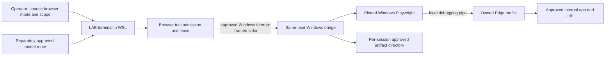
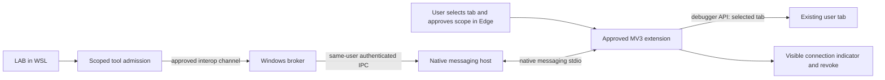
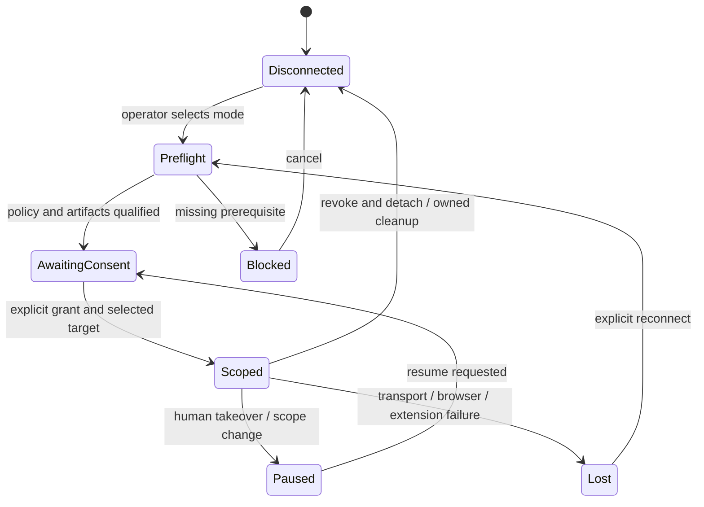

# Proposed browser boundary and terminal experience

**DESIGN — NOT IMPLEMENTED.** Every component named “LAB browser” below is a proposal. No diagram or sketch is a successful connection record. Evidence and compatibility limits: [SOURCES.md](SOURCES.md), [OPTIONS.md](OPTIONS.md).

## Owned Windows Edge from WSL



The bridge keeps browser launch, paths and lifecycle on the browser's OS. Native Playwright channel launch uses a debugging pipe in inspected source [S11](SOURCES.md#s11). WSL interoperability supports starting Windows executables [S18](SOURCES.md#s18), but reliable framed duplex transport and cancellation here remain **U**. An implementation must prove them; it must not silently fall back to a public TCP listener.

Direct WSL CDP is an optional adapter, not the default architecture: `LAB → approved mirrored IPv4 loopback → explicitly enabled Windows Edge endpoint`. NAT host addressing requires a different approved transport. A remote deployment replaces local interop with an authenticated, encrypted, identity-bound connection to a browser-side broker. All browser protocols remain behind that broker.

## Existing selected tabs through an extension



Native messaging is browser-initiated: the extension opens its host connection; it is not a TCP service to which WSL can directly connect. Host and broker need a rendezvous, for example a Windows named pipe with same-user ACLs and a per-run challenge. That pairing is **new design**, not provided by the native messaging protocol. Validate extension ID through `allowed_origins`, executable ownership and the authenticated LAB run; an extension ID alone is not agent authorization. Message size limits require chunked/bounded artifact handling. [S08](SOURCES.md#s08)

Playwright's existing extension is an alternative implementation candidate, not the native host in this diagram. Its source uses a relay WebSocket and tab groups, with a separate approval flow [S13](SOURCES.md#s13). Evaluate exact bundle and permissions before reuse; never assume its relay automatically crosses WSL networking or enforces LAB read-only scope.

## Admission and lifecycle contract

**R — enforce before browser access**, outside model instructions:

- A connection record binds run ID, OS user, adapter/version, browser ownership, selected target IDs, allowed origins, action class, artifact roots, generation and expiry. UI labels are not identity.
- Initially expose finite DOM/AX/screenshot reads. Arbitrary JS evaluation, navigation, clicks, typing, file access, network interception, browser/context creation and protocol passthrough are excluded unless explicitly granted. Reads can reveal sensitive page content; redaction/output approval remains necessary.
- No cookie, credential, storage-state or password extraction/export tools. No profile copying. Do not log endpoint secrets, URL query/fragment data, form contents or network headers by default.
- Selected-tab scope includes only explicitly approved frames/descendants. New popups, other origins, new tabs and target replacement pause for scope review. A target ID must never be guessed from title or list order.
- One writer per tab; default one lease holder even for reads, to avoid unstable evidence. Concurrent independent agents get separate owned profiles. Read-sharing, if added later, requires snapshot consistency and explicit grants.
- Human ownership pauses queued actions. A visible browser-side revoke cancels pending operations and drops the lease; it must work even if LAB crashes. CDP outside the broker cannot be made safe merely by hiding tabs in the UI.
- Ambiguous actions are recorded as `outcome unknown`, not retried. Reconnect gets a new generation, reacquires consent, refreshes target identity and discards stale locators.



No “connected” state before backend identity, scope and lease verification. Disconnect of an existing browser means detach only; it does **not** disable a pre-existing debugging endpoint. Disconnect of an owned browser may close that owned process; show retained/deleted profile and artifact choices explicitly. Never close all Edge processes or delete a user directory by wildcard.

## Security boundary

A loopback port is reachable by other suitably privileged local processes and is not per-user authentication. Random ports, URL secrecy, a WebSocket origin check or an airgap do not authenticate an agent. Prefer an inherited pipe for owned launch and ACL-restricted IPC for same-user brokers. If local adversarial users must be excluded, prove OS isolation and handle inheritance; otherwise use a distinct OS account/VM approved by the enterprise. No claim of hostile same-user isolation is made.

For remote machines require authenticated TLS or approved SSH, host identity validation, per-client authorization, bounded leases and firewall rules limited to the broker. Browser protocol endpoints must not be forwarded indiscriminately. Do not expose raw CDP, WebDriver, Playwright server or MCP over unauthenticated LAN HTTP. MCP origin validation and authentication are transport requirements; they do not replace the tab/action grant. [S19, S21](SOURCES.md)

Page contents are untrusted task input. A page cannot authorize broader tools, change model destination or approve a task. Browser observations remain evidence candidates under the existing ledger; they do not alter LAB/Relay/Herdr or Pi acceptance contracts.

## Terminal UX sketches

```text
DESIGN ONLY — no connection has been attempted
Connect browser
  > Dedicated automation browser (separate LAB profile)
    Existing browser / user-selected tab (requires approved route)

Dedicated → target
  Windows Edge on this host · Windows bridge
  Profile: new LAB-owned session
  Access: inspect only   Files: disabled
  [Review prerequisites] [Cancel]

Existing → choose attachment
  Approved extension + browser-side chooser
  Approved pre-enabled CDP endpoint (advanced; broader backend access)
  No endpoint/extension? Explain prerequisite; offer dedicated mode.
  [Request browser-side consent] [Cancel]

Select tab — DESIGN placeholder labels, not discovered tabs
  Selection takes place in browser, or in approved endpoint's scoped picker
  [selected fixture tab]  Origin: approved fixture origin
  Access: inspect only  Screenshots: separately approved
  [Grant this scope] [Cancel]

Connected scope — DESIGN state after future successful verification
  Session: <run>  Browser: Windows Edge  Mode: existing / borrowed
  Tab: <approved target>  Origin: <approved origin>
  Lease: inspect only  Writer: none  Files: disabled
  [Pause for human] [Request action grant] [Disconnect]

Disconnect
  Existing: detach; preserve tab/profile; endpoint may remain enabled
  Dedicated: close owned browser; choose owned artifact/profile retention
  Result: disconnected / cleanup incomplete / outcome unknown
```

Selection must not enumerate a human profile merely to populate onboarding. Before authorization, show installed approved adapter metadata or supplied connection configuration only. The future tab chooser is a consent boundary, not permission to inspect tabs during this study. A clearly labelled self-contained [DESIGN HTML](DESIGN.html) mirrors the proposed flow; no live site or user data is embedded.
