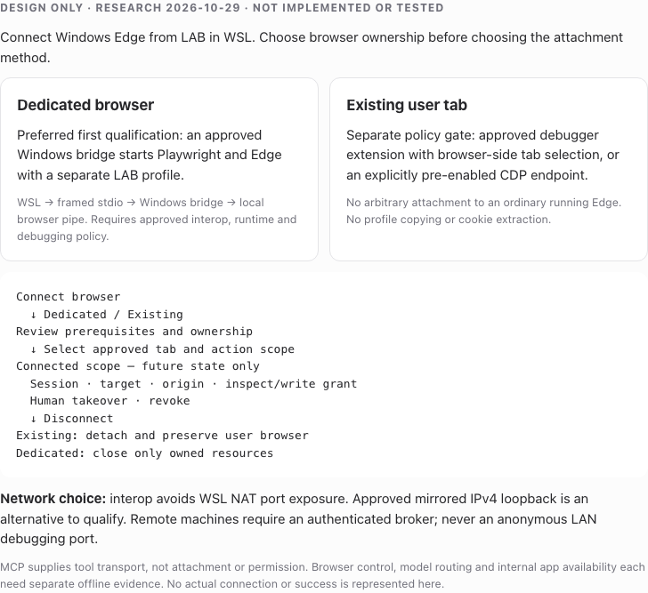

# Edge connection in an airgap — research decision

**2026-10-29 · RESEARCH ONLY · no implementation or browser experiment.**

LAB-HARNESS can plausibly control an approved local Edge installation without internet access. This does **not** establish that the installed enterprise browser permits control, that an existing personal session can be attached, that an internal application works offline, or that the selected model route is offline.

## Recommendation

**R — preferred first qualification:** for Linux WSL LAB and Windows Edge on the same host, use a small, same-user **Windows browser bridge**, launched through approved WSL interoperability with a framed stdio connection. Let a pinned Windows Playwright runtime launch the approved `msedge` channel with a **dedicated, LAB-owned profile**, keeping its browser control pipe on Windows. This avoids a Windows debugging TCP listener and WSL NAT reachability as requirements. The bridge is a proposed component, not existing LAB functionality. Its installation and interop permission are decision gates. Playwright's pinned launch source uses a debugging pipe; the pipe still requires enterprise permission. [S11](SOURCES.md#s11)

**R — simpler conditional alternative:** if mirrored networking is already approved and a dedicated Edge CDP endpoint is explicitly permitted, a WSL client can qualify loopback `connectOverCDP`. Do not enable a LAN-facing debug port to make NAT work. CDP has less Playwright fidelity than a Playwright-owned connection; selecting a tab in LAB does not narrow the raw browser endpoint's authority. [S01, S04, S09](SOURCES.md)

**R — existing user tabs:** treat this as a separate product mode. Prefer an approved MV3 debugger extension with explicit browser-side tab selection and visible revocation, plus a same-user native host/broker, when enterprise deployment permits it. Evaluate Microsoft's Playwright Extension as a reuse candidate before building one; its inspected manifest has broad permissions and no native messaging permission, so it is **not** the proposed native-host design. Its published flow and our offline managed deployment need separate qualification. A dedicated profile remains the fallback; never copy the user's profile or export cookies to simulate attachment. [S06–S08, S12–S15](SOURCES.md)

If DevTools policy blocks the intended targets, neither direct CDP nor the debugger extension is an approved workaround. WebDriver is an alternative automation stack, not a policy bypass. If the organization cannot approve either route, the research outcome is **unsupported under current policy**, not a request to weaken it. [S03](SOURCES.md#s03)

## Decision branches

| Requirement / condition | Candidate | What changes for the user |
| --- | --- | --- |
| Dedicated browser, Windows bridge allowed | Windows Playwright launch; WSL framed stdio | Separate profile; user signs in normally if allowed; owned window |
| Dedicated browser, no bridge, approved mirrored loopback | WSL Playwright over Windows CDP | Explicit debug-enabled launch; separate profile; lower fidelity to qualify |
| Existing tabs, extension/native host approved | Tab-scoped extension + host | Install/approve extension; select tab and permissions in browser |
| Existing tabs already in an approved debugging instance | Attach CDP, optionally through bridge | No new launch if already enabled; broad endpoint trust remains |
| Existing arbitrary Edge without debugging or extension | No supported general attach established | Explicitly explain prerequisites; offer dedicated mode |
| Existing Selenium estate / driver packaging preferred | Windows EdgeDriver behind authenticated bridge | Matched driver/browser; dedicated session preferred |
| Neither debug nor approved extension is permitted | Stop at policy gate | No implementation route selected |

## Separate meanings of “offline”

1. **Browser control:** local installed runtime, browser, optional driver/extension and dependencies; no runtime package resolution, downloads, cloud relay or CDN frontend.
2. **Model:** independently approved local/intranet inference destination, credential handling and egress enforcement. A local browser MCP server does not make cloud inference local.
3. **Application:** internal DNS, TLS trust, SSO/IdP and assets must be reachable within the airgap. An intranet page that redirects to public identity/CDN services is not qualified.

The repository's [architecture](../../architecture.md) and [provider design](../model-providers.md) retain their existing acceptance, admission and offline limitations. Browser attachment never accepts a ledger task or qualifies controlled model admission.

## Deliverables and confidence

- [OPTIONS.md](OPTIONS.md): attachment, capability, topology and recovery comparison.
- [ARCHITECTURE.md](ARCHITECTURE.md): proposed boundaries, diagrams, concurrency and terminal UX.
- [PREREQUISITES.md](PREREQUISITES.md): future operator checklist and supply chain gates.
- [SOURCES.md](SOURCES.md): dated primary evidence, immutable source pins and drift caveats.
- [POC-PLAN.md](POC-PLAN.md): **NOT EXECUTED**, falsifiable tests and decision gates.

**D** means official documentation; **S** means inspected source at an immutable commit; **R** means LAB recommendation/inference; **U** means unqualified. No live tabs, profiles, authentication, private sites or browser endpoints were inspected. During the initial study no packages were installed, services started, browser flags enabled, policies/firewall changed, runtime models called or subagents used. A subsequent, separately authorized independent read-only Codex review is part of publication readiness. Only public research and repository reads were performed before authoring these documents. Local documentation checks are recorded in the PR and handoff; none are interoperability tests.

## Questions that block choosing a production route

These do not block this study; answer before authorizing the PoC:

1. Is continuity with a currently signed-in Windows user tab mandatory, or is a dedicated profile with normal interactive sign-in acceptable?
2. What are the effective `RemoteDebuggingAllowed`, `DeveloperToolsAvailability` and target allow/block policies for the actual Edge version?
3. May the organization deploy an MV3 debugger extension and native messaging host; is Windows AD/hybrid joined, and is there an approved internal update location?
4. May LAB start an approved same-user Windows bridge through WSL interop? If not, is mirrored networking already approved, or is an authenticated broker/tunnel available?
5. Which Windows/WSL/Edge builds and internal SSO route are supported, and must unrelated local users or untrusted local processes be isolated from the control channel?

## Actual documentation validation

On 2026-10-29: local Markdown file-link existence and code-fence balance checks passed for all six Markdown files; HTML had no external resource references and retained its DESIGN label. T3 `html_preview` rendered the self-contained mockup at 728px/light (667px content height) and 360px/dark (1029px), both with empty console messages. Staged `git diff --check` passed; seven added files are exclusively inside this research directory. These checks do not test Edge, WSL, SSO, browser policies or the proposed bridge. No product tests/full gate or CI watcher was run for this docs-only study.

## DESIGN visual evidence

The image is the original self-contained HTML render, not a live browser-control screenshot. [HTML source](DESIGN.html) and [capture provenance and byte hashes](DESIGN.json) identify the exact artifact.

## Publication readiness follow-up

The initial publication failure was an absolute user path in the checkpoint record. It has been replaced with a sanitized worktree identifier; citations are unchanged. The unmodified publication checker passes after the normal explicit refresh: 190 allowed files, 189 current hashes and all nine pinned Relay files. Manifest inspection confirms that only the nine research artifacts (the original seven plus PNG/provenance) were added; existing current identities and immutable original anchors are unchanged. Screenshot/provenance hashes and local documentation links were verified. These remain documentation checks, not executed PoC results.
