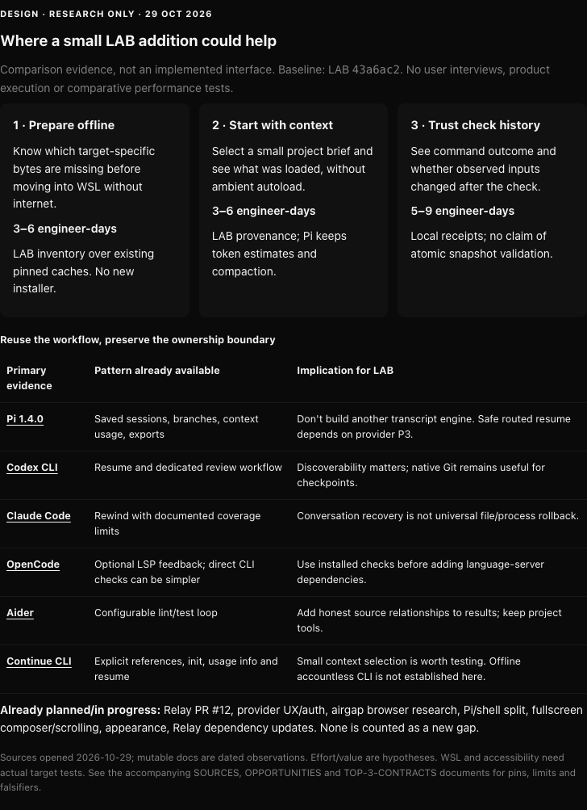

# Engineer workflows worth exploring in LAB-HARNESS

**Research only, 2026-10-29. No implementation authorization.** Against remote
main `43a6ac2267d0261998453d56bd7f834956531812`, the best small opportunities are:

1. **Offline readiness for the actual target:** report all missing/unverified
   Linux runtime and package-cache requirements before transfer into WSL/airgap.
   Reuse existing pins and verifiers; start with a read-only inventory, not a new
   installer. Estimated 3–6 engineer-days.
2. **Explicit project briefing:** help select a bounded set of project
   instructions, preview them and track what was loaded. LAB deliberately disables
   automatic context files; Pi already owns context estimation and compaction.
   Estimated 3–6 days.
3. **Source-linked check receipts:** retain command outcome and observed input
   hashes, then reveal changed/unknown inputs before handoff. Reuse project tests
   and Herdr; unchanged hashes are not proof of an atomic tested snapshot.
   Estimated 5–9 days.

These rank highest because they work with existing local/self-hosted or LiteLLM
routes, require no cloud service or new model capability, and have small falsifiable
boundaries. Estimates include focused tests/review but not hardware availability
or upstream waits; they are not measured delivery commitments.

Pi already supplies saved sessions, branching, context visibility and an example
checkpoint extension. Search and explicit local skills already ship in LAB.
Codex, Claude Code, OpenCode, Aider and Continue demonstrate useful resume/review,
context and test-feedback patterns; that is supply-side evidence, not proof of
LAB demand. The only direct demand evidence here is Brian's brief. No interviews,
usage telemetry, model accounts, private codebases or live user sessions were used.

Recovery is a strong next candidate, but distinguish a cheap private handoff
card from routed transcript replay. Provider design P1 intentionally refuses
resume/import until P3 qualifies destination/history handling. A new recovery
proposal must not bypass that restriction. Robust undo and bounded collaborators
also have heavier correctness costs than a menu or message bus suggests.

Built-in Relay PR #12, provider UX/auth design (`679ab07e`), airgap browser research
(`7ad47d74`), Pi/regular-shell split, fullscreen/bottom composer/scrolling,
appearance and requested Relay dependency updates are **already in progress or
planned**, excluded as newly discovered gaps. This study proposes no competing
renderer, provider engine, gateway, vector service or central policy system.

## Read and decide

- [Current versus gaps](CURRENT-VS-GAPS.md): baseline, competitors and boundaries.
- [Prioritized opportunities](OPPORTUNITIES.md): ten workflow stories, evidence,
  workarounds, adopt/build/defer decisions, dependencies, risks and confidence.
- [Top three contracts](TOP-3-CONTRACTS.md): small file boundaries, acceptance
  and explicit conditions under which to drop each proposal.
- [Sources](SOURCES.md): primary source pins/dates, local evidence and limits.
- [Review](REVIEW.md): critical self-review, checks and unresolved questions.
- [Design comparison](COMPARISON.html): self-contained research matrix; not a
  screenshot or evidence of implemented LAB UI.

Before adopting a proposal, observe a small voluntary trial on owned sample
projects: prepare one disconnected installation, start one unfamiliar-repo task,
and review one edit/check/edit cycle. Measure missing transfer iterations,
briefing effort and stale-result recognition against current manual workflows.
No benefit is claimed until that trial. WSL, accessibility and self-hosted model
quality remain unqualified by this document-only study.

Publication manifest integration belongs to root
`64847d95-5062-48cb-9506-4d3c9e7f19c5`. This branch changes only
`docs/research/engineer-features/**` in the initial study; no runtime edits.
Root subsequently authorized normal publication-manifest entries for these
artifacts only; see the readiness follow-up in [REVIEW.md](REVIEW.md).

## DESIGN screenshot and readiness update

[Capture provenance and hashes](COMPARISON.json) identify the unchanged HTML
from the original study. This is static documentation evidence, not runtime proof.
The snapshot above preserves its original baseline/status date. Readiness work
merged main `9a29db3bef718fa5c08c791d98a4c165210b89de`, retaining the now-merged
[provider UX research](../provider-connection-ux/SUMMARY.md) and
[airgap browser research](../airgap-browser/SUMMARY.md). Both remain research,
not shipped capabilities. PR #12 and root-owned monitoring/merge stay separate.
