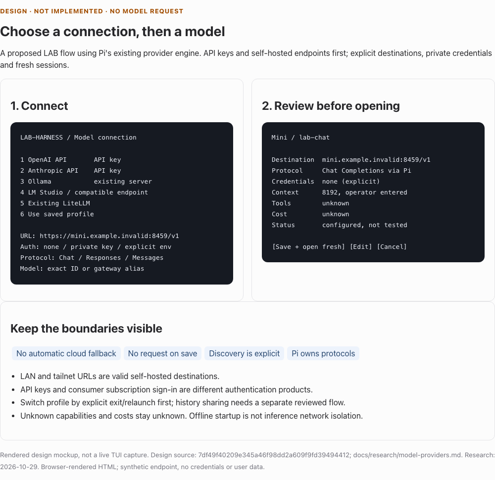

# Model connections, profiles and switching

Research date: **2026-10-29**. Status: **design for independent review, not an
implemented provider feature**. Immediate home-directory and remote self-hosted
URL fixes are PR #8, separately reviewed at
ffef0a2315b55efceb973aa150d687855f9fb0fd and distributed by bootstrap e709361.
This document does not qualify controlled LAB request admission.

The image is a browser-rendered design mockup of source 7df49f4, captured with
T3 html_preview at 1000px/light on 2026-10-29. It is not a live TUI screenshot,
provider test or inference evidence. [Self-contained HTML](../evidence/provider-design.html)
and [capture identity/reproduction](../evidence/provider-design.json).

## Decision

Use Pi's provider engine, protocol adapters, model metadata, credential APIs and
session conversion. LAB owns a small explicit connection/profile layer and its
terminal setup, private storage, selection and diagnostic policy. Do not build
another inference router, deploy LiteLLM, or infer a protocol from a model name.

Build API-key and explicitly unauthenticated profiles first: OpenAI, Anthropic
(Claude API), Ollama, LM Studio/OpenAI-compatible, and existing LiteLLM. Start
with manual exact model IDs/aliases and optional explicit discovery later.
Changing profile initially means exit and relaunch into a fresh conversation.
In-process cross-destination switching and subscription OAuth need separate
proofs; they are not prerequisites for usable API-key support.

“Configured”, “metadata reachable”, “inference observed” and “tool round trip
observed” are separate states. Saving settings sends no request. A URL being
loopback does not establish local inference; a remote/tailnet URL does not make
a self-hosted model a LiteLLM service.

## Evidence and version discipline

**S**: statically source-proven at the linked commit. **D**: described by current
official documentation, which can differ from an installed server. **R**: LAB
recommendation/inference. **U**: untested or unresolved. No research task logged
in, read credentials, installed a vendor app, called a model or tested billing.

| Product | Inspected stable source | Selection caveat |
| --- | --- | --- |
| Pi | [1.4.0, 4a080252](https://github.com/earendil-works/pi/releases/tag/v1.4.0), published 2026-10-21 22:49:48 UTC | Official historical b857fbd8 is [203 commits ahead](https://api.github.com/repos/earendil-works/pi/compare/4a080252f06caf63a525d7873c5d94d3c23887e0...b857fbd8a9225ab7b0c15d7a6965b2f109c9317a) despite the same package version; do not use its APIs as release evidence. |
| OpenCode | [2.2.2, 098aa7fd](https://github.com/anomalyco/opencode/releases/tag/v2.2.2), published 2026-10-29 18:43:03 UTC; CLI and desktop | GitHub's latest-marked release was still 1.19.5/810c0eba. The full release list and CLI package identify the newer non-prerelease; findings here use 2.2.2. |
| Aider | [0.86.2, 253f0368](https://github.com/Aider-AI/aider/commit/253f0368b873ba30d8ee26e463718f0c03614ddf), uploaded 2026-02-12 | [PyPI](https://pypi.org/pypi/aider-chat/0.86.2/json) is newer than GitHub's latest release 0.86.0. |
| Continue extension | [2.0.0-vscode, 03b05ef6](https://github.com/continuedev/continue/releases/tag/v2.0.0-vscode), 2026-06-19 | 2.1.0-vscode is prerelease; do not conflate extension and CLI. |
| Continue CLI | [1.5.47, d3f60ba9](https://github.com/continuedev/continue/commit/d3f60ba9dd3fb5bfd3c91d6fbb41ce1aa768db45), 2026-06-18 | [npm gitHead](https://registry.npmjs.org/@continuedev/cli/1.5.47) establishes this separate release line. |

Full source pins: Pi 4a080252f06caf63a525d7873c5d94d3c23887e0;
OpenCode 098aa7fd6e02b03d6fc410f0b052038c7d4c5e81;
Aider 253f0368b873ba30d8ee26e463718f0c03614ddf;
Continue extension 03b05ef60c378ff06f9e39ada2e22c95fe9ef6ad;
Continue CLI d3f60ba9dd3fb5bfd3c91d6fbb41ce1aa768db45.

Two isolated read-only Codex high/default tasks researched disjoint scopes:
research-provider-pi-opencode-v1 (Pi/OpenCode/OpenAI/Anthropic) and
research-provider-aider-continue-v1 (Aider/Continue/Ollama/LM Studio/LiteLLM).
Both started from LAB ffef0a2, explicit base 4bd2e7a, with clean app-bound
worktrees. The coordinator alone writes this document and ADR. Source evidence
does not establish interoperability or cloud account entitlement.

## Concrete market lessons

| Product and observed behavior | Adopt for LAB | Deliberate difference |
| --- | --- | --- |
| **S, Pi:** native login, model picker, scoped models, reasoning selection and models.json | Reuse supported mechanisms and protocol conversion; distinguish session choice from saved default | LAB's saved profile must be reconciled with native defaults; current launcher rewrites settings every start. |
| **S, OpenCode 2.2.2:** connect first, then provider-filtered models; favorites/recents and variants | Clear active destination/model, recent selections, useful model details | No upsells or implicit provider selection. [Picker source](https://github.com/anomalyco/opencode/blob/098aa7fd6e02b03d6fc410f0b052038c7d4c5e81/packages/tui/src/component/dialog-model.tsx#L19-L159). |
| **S, OpenCode:** stored credential and catalog-refresh failure are separate states; cancellation is explicit | Keep a saved connection when discovery fails; allow retry or manual ID | Do not restart authentication or erase a valid profile for a metadata outage. [Controller](https://github.com/anomalyco/opencode/blob/098aa7fd6e02b03d6fc410f0b052038c7d4c5e81/packages/app/src/providers/connect/controller.ts#L228-L282). |
| **S, OpenCode:** named accounts, auth-source labels; deleting active credential can select a replacement | Stable labels, explicit source and removal UI | Removing active LAB credentials stops/asks; it must not select another billing identity. [Removal](https://github.com/anomalyco/opencode/blob/098aa7fd6e02b03d6fc410f0b052038c7d4c5e81/packages/core/src/credential.ts#L287-L348). |
| **S, Aider:** explicit model or environment-based onboarding; aliases and separate metadata files | Exact ID distinct from friendly name; unknown metadata warning | No ambient-key-driven provider choice or automatic remote price-data refresh. [Onboarding](https://github.com/Aider-AI/aider/blob/253f0368b873ba30d8ee26e463718f0c03614ddf/aider/onboarding.py#L44-L149), [metadata cache](https://github.com/Aider-AI/aider/blob/253f0368b873ba30d8ee26e463718f0c03614ddf/aider/models.py#L149-L220). |
| **S, Aider:** model switch retains weak/editor models; edit-format changes may summarize history | Show all helper-model routing, not just the main model | Initial LAB phase has one selected profile; no hidden helper route or summary on switch. [Switch](https://github.com/Aider-AI/aider/blob/253f0368b873ba30d8ee26e463718f0c03614ddf/aider/commands.py#L87-L112). |
| **S, Continue:** masked key input and distinct local setup; local onboarding can poll/warm a model | Clear provider categories and private entry | No automatic polling, downloads, model loading or empty warm-up inference. [Local onboarding](https://github.com/continuedev/continue/blob/03b05ef60c378ff06f9e39ada2e22c95fe9ef6ad/gui/src/components/OnboardingCard/components/OnboardingLocalTab.tsx#L64-L105). |
| **S, Continue:** unavailable saved model selects first configured model for role | Explain unavailable selection with repair actions | LAB leaves selection unchanged instead of substituting. [Resolver](https://github.com/continuedev/continue/blob/03b05ef60c378ff06f9e39ada2e22c95fe9ef6ad/core/config/selectedModels.ts#L10-L76). |

Documentation drift matters. Continue's live capability guides disagree on
whether an empty capability list can disable heuristics; the pinned YAML loader
and tool helper honor explicit false. Its documented secret precedence also
differs from the inspected implementation. We will publish one tested LAB order,
rather than copy ambiguous precedence. [Capability mapping](https://github.com/continuedev/continue/blob/03b05ef60c378ff06f9e39ada2e22c95fe9ef6ad/core/config/yaml/models.ts#L103-L125),
[secret lookup](https://github.com/continuedev/continue/blob/03b05ef60c378ff06f9e39ada2e22c95fe9ef6ad/core/config/yaml/LocalPlatformClient.ts#L15-L24).

## Providers, protocols and credentials

The following are proposed presets, not claims that a particular installed
server implements every compatible endpoint. Editable endpoint defaults are
suggestions; preserve custom mount paths and never append /v1 blindly.

| Choice | Suggested base URL | Pinned Pi API | Authentication and model selection |
| --- | --- | --- | --- |
| OpenAI API | https://api.openai.com/v1 | openai-responses; advanced explicit Chat choice where supported | Private API key; exact model from pinned catalog/manual ID. No paid default selected automatically. |
| Anthropic / Claude API | https://api.anthropic.com | anthropic-messages | Private API key; exact Claude API model. Does not imply Claude subscription access. |
| Ollama | http://localhost:11434/v1 | openai-completions initially | Explicit none or private key for authenticated proxy; exact model/tag. Native Ollama NDJSON is not this adapter. |
| LM Studio | http://localhost:1234/v1 | openai-completions initially | Explicit none or private server token; exact model identifier. |
| OpenAI-compatible | Operator supplies base URL | Explicit supported API; Chat suggested | Exact ID/alias and credential choice, independent of hostname/brand. |
| Existing LiteLLM | Operator supplies deployment URL | Explicit Chat, Responses or Messages matching deployment | Client/virtual key, not administrative master key; exact public alias. LAB installs no gateway. |

**S:** Pi's openai-completions adapter calls Chat Completions, not the legacy
prompt Completions API. Responses and Anthropic Messages are different adapters,
with different tool/stream/history shapes. [Chat implementation](https://github.com/earendil-works/pi/blob/4a080252f06caf63a525d7873c5d94d3c23887e0/packages/ai/src/api/openai-completions.ts#L371-L384),
[Responses implementation](https://github.com/earendil-works/pi/blob/4a080252f06caf63a525d7873c5d94d3c23887e0/packages/ai/src/api/openai-responses.ts#L215-L228).
**D:** OpenAI documents these protocol distinctions and API bearer authentication.
Use Pi's conversions instead of converting an Anthropic model into a Chat model
by changing its label. [OpenAI authentication](https://developers.openai.com/api/reference/overview#authentication),
[protocol migration](https://developers.openai.com/api/docs/guides/migrate-to-responses),
[Anthropic Messages](https://platform.claude.com/docs/en/api/messages).

Accept any explicitly entered valid HTTP(S) host, IPv6, LAN or tailnet address.
Refuse embedded URL credentials, query/fragment secrets and non-HTTP schemes.
Show the normalized destination before a key is attached. Changing an endpoint
creates a new connection revision and requires explicit confirmation of the
credential destination. No redirects carrying credentials to another origin.

### API keys and subscription login are different products

**D:** OpenAI now documents an official OSS ChatGPT plan-sharing flow. It requires
validated account identity/nonce, retained issued client ID, registration reuse
and constrained Responses behavior. That is different from ordinary API-key
billing. **S:** pinned Pi includes a direct flow, but its ID-token/account handling
and tool shape have gaps against the current docs. Therefore LAB's first
provider phase offers API keys; it does not promise audited ChatGPT subscription
support or implement a replacement OAuth engine. [Official sign-in](https://developers.openai.com/siwc/token-sharing-open-source/sign-in),
[preview limits](https://developers.openai.com/siwc/token-sharing-open-source/preview-limitations),
[pinned Pi implementation](https://github.com/earendil-works/pi/blob/4a080252f06caf63a525d7873c5d94d3c23887e0/packages/ai/src/auth/oauth/openai-chatgpt.ts#L162-L205).

**D/S:** Anthropic's current guidance directs product developers to API keys or
supported cloud providers; upstream Pi's OAuth registration and extra-usage
warning do not establish included subscription entitlement for LAB. Claude API
configuration is supported in the proposed first phase; consumer subscription
login remains a separately audited integration. Aider's OpenRouter PKCE flow
exchanges for an API key, another example of why a browser login is not evidence
of subscription access. [Anthropic guidance](https://support.claude.com/en/articles/13189465-log-in-to-your-claude-account),
[Pi provider](https://github.com/earendil-works/pi/blob/4a080252f06caf63a525d7873c5d94d3c23887e0/packages/ai/src/providers/anthropic.ts#L74-L89),
[Aider exchange](https://github.com/Aider-AI/aider/blob/253f0368b873ba30d8ee26e463718f0c03614ddf/aider/onboarding.py#L166-L194).

### Discovery and capability evidence

| Service | Explicit discovery option | What it does not establish |
| --- | --- | --- |
| Standard OpenAI | GET /v1/models | Context, tools, reasoning, vision or successful generation. [Reference](https://developers.openai.com/api/reference/resources/models/methods/list). |
| Anthropic | Paginated Models API, version-dependent nullable metadata | Missing capability values remain unknown; compatible proxies may not implement it. [Reference](https://platform.claude.com/docs/en/api/models/list). |
| Ollama | GET /api/tags, selected POST /api/show | Model maximum context differs from configured num_ctx; tags do not establish tool quality or local-only routing. [List](https://docs.ollama.com/api/tags), [details](https://docs.ollama.com/api-reference/show-model-details). |
| LM Studio | /v1/models; optional richer /api/v1/models | Downloaded/JIT-loadable is not loaded. Instance context differs from maximum capacity. [Native metadata](https://lmstudio.ai/docs/developer/rest/list). |
| LiteLLM | Deployment's permitted /v1/models | Listing can differ from caller permissions, hidden aliases or downstream routes. Empty listing must not forbid manual alias. [Discovery](https://docs.litellm.ai/docs/proxy/model_discovery). |

Discovery is user-triggered, bounded metadata traffic to the reviewed endpoint,
using that connection's credential. No scanning localhost/ports, background
refresh, pulls, loads, warm-up prompts or administrative gateway calls. Cache the
last successful inventory with observation time and stale label; manual exact
IDs always remain available. Failure keeps saved configuration usable.

**D:** Ollama's compatible Responses API is stateless, while LM Studio describes
previous_response_id. Never move endpoint-owned state IDs between servers.
LM Studio supports optional server tokens (0.4.0+) and can fall back to prompted
tool formats whose malformed outputs remain plain text. Endpoint tool support,
model training and an observed tool round trip are three different facts.
[Ollama compatibility](https://docs.ollama.com/api/openai-compatibility),
[LM Studio Responses](https://lmstudio.ai/docs/developer/openai-compat/responses),
[authentication](https://lmstudio.ai/docs/developer/core/authentication),
[tool limitations](https://lmstudio.ai/docs/developer/openai-compat/tools).

**S:** Pi custom-model defaults include 128K context, 16K output, text-only,
reasoning false and zero prices; they are not discovered server facts. Its Model
interface has no first-class tool_call boolean. LAB records metadata provenance
(pinned catalog, server-reported, operator-entered, legacy assumption, unknown),
tool status separately, configured context separately from maximum, and unknown
price separately from zero. [Default injection](https://github.com/earendil-works/pi/blob/4a080252f06caf63a525d7873c5d94d3c23887e0/packages/coding-agent/src/core/provider-composer.ts#L216-L249),
[Model type](https://github.com/earendil-works/pi/blob/4a080252f06caf63a525d7873c5d94d3c23887e0/packages/ai/src/types.ts#L832-L878).

## LAB state and configuration contract

Proposed v2 envelope, abbreviated for readability; this is a schema design, not a
file users should create before implementation:

~~~json
{
  "version": 2,
  "revision": 1,
  "defaultProfileId": "profile-example",
  "connections": [{
    "id": "connection-example",
    "label": "Mini LM Studio",
    "preset": "lmstudio",
    "providerId": "lab-connection-example",
    "endpoint": "https://mini.example.invalid:8459/v1",
    "api": "openai-completions",
    "credentialRef": { "kind": "none" },
    "routingDeclaration": "self-hosted"
  }],
  "profiles": [{
    "id": "profile-example",
    "connectionId": "connection-example",
    "modelId": "lab-chat",
    "metadata": {
      "contextWindow": 8192,
      "maxTokens": 1024,
      "input": ["text"],
      "reasoning": false,
      "source": "operator-entered",
      "toolSupport": "unknown",
      "pricing": { "status": "unknown" }
    }
  }]
}
~~~

The implementation must validate the complete versioned structure, unique IDs,
references, bounds and protocol values. IDs are generated opaque identifiers,
not endpoint/model-derived aliases. Connection identity is stable; editing
endpoint/protocol/auth binding creates a revision captured by launch. Different
endpoints never share an accidental Pi provider identity. Friendly labels do
not replace exact model IDs, especially gateway aliases.

Credential references are explicit none, private-file opaque ID, or an explicitly
named environment variable. No secrets in project config, command arguments,
history, diagnostics or session annotations. No automatic import of vendor keys,
Pi/Codex/Claude auth, project .env files or credential commands. Literal key bytes
are forwarded through controlled interpolation, never inserted as Pi's executable
!command syntax. Current private-file ownership, no-symlink/no-hardlink, size and
0600 checks remain required. [Pi value resolution](https://github.com/earendil-works/pi/blob/4a080252f06caf63a525d7873c5d94d3c23887e0/packages/coding-agent/src/core/resolve-config-value.ts#L28-L85).

Precedence: explicit session/profile argument, then previously confirmed project
preference, then user default. Project preferences may reference an existing
approved profile only; they cannot supply a new endpoint, secret, executable
command or silent cloud activation. Initially omit automatic project preference
loading; an explicit launch argument is sufficient. List/profile status reads
metadata only; it must not resolve credentials, refresh OAuth or execute commands.
Pi's credential-list API supports that distinction. [Credential interface](https://github.com/earendil-works/pi/blob/4a080252f06caf63a525d7873c5d94d3c23887e0/packages/ai/src/auth/types.ts#L36-L94).

Keep release code, project sources, private connection state and native sessions
separate. Reuse the existing private HOME app root. Stage new revision files,
validate them and atomically publish a small active-manifest pointer under an
exclusive writer lock. Partial writes leave the previous revision active.
Readers bind one revision; a running generation never rereads a changed endpoint
or credential. Never overwrite a running connection in place.

### Migration from route v1

1. Validate current route and private key with existing guards; do not print key.
2. Create one legacy connection/profile with the exact endpoint/model and
   openai-completions protocol. Preserve local/litellm as origin metadata.
3. Reference the existing private key initially. Do not discover, reauthenticate,
   normalize paths beyond existing validation or send a prompt.
4. Preserve 8192 context, 1024 output, text-only and reasoning false as legacy
   assumptions. Record old zero prices as unknown cost, not free.
5. Preserve the existing agent/session directory and legacy lab-workspace provider
   binding. Do not rewrite transcripts or invent old endpoint provenance:
   native model_change records provider/model, not endpoint/key revision.
6. Publish v2 only after staging succeeds; retain v1 files and an explicit
   recovery path. Repeated migration is idempotent.
7. Malformed active v2, missing key, unsupported version or interrupted activation
   stops with recovery actions. Do not silently downgrade or choose a new route.

Later launches append a non-secret profile/revision/protocol annotation using
Pi's supported custom session entry, which is excluded from model context.
Existing historical sessions remain intact and marked routing-unknown where
evidence was never recorded. [Session types](https://github.com/earendil-works/pi/blob/4a080252f06caf63a525d7873c5d94d3c23887e0/packages/coding-agent/src/core/session-manager.ts#L69-L130).

## Terminal onboarding and everyday use

The sketches describe proposed behavior. They are not screenshots or working
commands at this design-only checkpoint. The separate launcher/PATH phase makes
bare lab discoverable without duplicating the current runtime launcher.

~~~text
LAB-HARNESS                         Project: ~/Projects/my app
Choose a model connection. Saving setup sends no model request.

1  OpenAI API                       API key; provider usage charges
2  Anthropic / Claude API           API key; not Claude subscription login
3  Ollama                           existing server, this machine or remote
4  LM Studio / OpenAI-compatible    existing server, LAN/tailnet allowed
5  Existing LiteLLM                 client connection; no gateway installed
6  Use saved profile
q  Configure later / quit

Choice: 4
Connection name: Mini
Base URL [http://localhost:1234/v1]: https://mini.example.invalid:8459/v1
Protocol [Chat Completions]: ...
Authentication: [none] / private key / explicit environment reference
Exact model ID or alias: lab-chat
Metadata: enter limits / pinned catalog / unknown
Optional: Discover models (sends metadata request)     [not automatic]
~~~

~~~text
Review connection
  Destination  mini.example.invalid:8459/v1
  Protocol     OpenAI Chat Completions through Pi
  Model        lab-chat
  Auth         none (explicit)
  Context      8192, operator entered
  Tools        unknown; not yet tested
  Cost         unknown
  Status       configured; no endpoint request made

[Save and open fresh workspace] [Edit] [Save without opening] [Cancel]
~~~

~~~text
LAB models
* Mini / lab-chat           self-hosted declaration  configured
  OpenAI / exact-model     API-key billing          configured
  Gateway / team-alias     gateway routing unknown  catalog stale

Current session: Mini. Saved default: Mini.
[Configure] [Choose for next fresh launch] [Set default] [Remove] [Cancel]

Changing destination sends future prompts to the new endpoint.
Phase 1: leave with /exit, select profile, open a fresh session.
Existing sessions remain available; no history copied automatically.
~~~

Proposed launch interface: lab, lab --project DIR, lab --configure,
lab --profile ID, lab --models and lab --help. List and configure work without
inference; private prompts require a TTY. Invalid profile/model/key keeps the
existing selection and offers configure/retry. NoTTY must never read downloaded
script bytes as answers. The direct absolute launcher remains a fallback when
PATH setup is incomplete or a foreign lab command exists.

## Pi integration and switching boundary

**S:** supported surfaces include models.json; registerProvider/unregisterProvider;
ModelRuntime; ModelRegistry refresh/find/getAvailable/getError; and native
credential/auth APIs. A configured-auth check is not an endpoint test. Refresh
can explicitly disable model-network access. Use static models.json first and
Pi's supported provider objects only for dynamic discovery/auth needs.
[Extension APIs](https://github.com/earendil-works/pi/blob/4a080252f06caf63a525d7873c5d94d3c23887e0/packages/coding-agent/src/core/extensions/types.ts#L1787-L1986),
[registry](https://github.com/earendil-works/pi/blob/4a080252f06caf63a525d7873c5d94d3c23887e0/packages/coding-agent/src/core/model-registry.ts#L44-L125).

Phase-one launch compiles an exactly validated single-profile configuration with
a unique provider ID, exact model entry and only its explicit credential. Keep
current isolated HOME/XDG/environment/resources and fresh-session behavior.
Disable cache warming explicitly. Successful explicit CLI model resolution
bypasses startup default restoration; malformed unique-provider configuration
produces diagnostics before normal interactive generation.
[Startup source](https://github.com/earendil-works/pi/blob/4a080252f06caf63a525d7873c5d94d3c23887e0/packages/coding-agent/src/main.ts#L798-L853),
[diagnostic exit](https://github.com/earendil-works/pi/blob/4a080252f06caf63a525d7873c5d94d3c23887e0/packages/coding-agent/src/main.ts#L915-L952).

This is a **bounded initial-launch policy**, not generation admission or an OS
sandbox. Pi's resolver can fuzzily match or synthesize unknown models, so LAB
must validate exact generated membership rather than treating CLI success as
proof. list-models is a human fuzzy listing that can exit successfully on no
match; it is not a pure strict validation gate. Native login/reload/extensions
can deliberately change runtime assumptions. Native controlled LAB remains
unqualified. [Resolver edge cases](https://github.com/earendil-works/pi/blob/4a080252f06caf63a525d7873c5d94d3c23887e0/packages/coding-agent/src/core/model-resolver.ts#L459-L609).

Future in-process switching must await idle or explicit abort followed by idle,
stage the target connection revision, confirm history routing and then call
supported setModel. setModel checks auth and records model_change but does not
itself await idle or transact credentials/endpoint/model.
[Idle/abort](https://github.com/earendil-works/pi/blob/4a080252f06caf63a525d7873c5d94d3c23887e0/packages/coding-agent/src/core/agent-session.ts#L2495-L2514),
[model change](https://github.com/earendil-works/pi/blob/4a080252f06caf63a525d7873c5d94d3c23887e0/packages/coding-agent/src/core/agent-session.ts#L2535-L2560).

Pi converts histories between protocols, including tool IDs, missing results,
foreign reasoning signatures and unsupported images. It is not lossless history
equivalence. Cross-destination continuation must warn that prior messages and
tool results will be sent; offer fresh session; preserve originals; never rerun
old tools, reuse remote state IDs on another endpoint or silently discard
content. Missing saved profile/model/auth pauses instead of substituting.
[Conversion](https://github.com/earendil-works/pi/blob/4a080252f06caf63a525d7873c5d94d3c23887e0/packages/ai/src/api/transform-messages.ts#L62-L223).

## Network, failures, retries and cost

**S/D:** Pi --offline suppresses startup networking, not inference egress. LAB's
--offline also requires cached runtimes; neither is a network sandbox. Ollama
on loopback can route cloud models when signed in. A gateway can perform its
own retries/fallbacks. Show operator-declared route and observed endpoint,
without claiming downstream locality or airgap enforcement.
[Pi flag](https://github.com/earendil-works/pi/blob/4a080252f06caf63a525d7873c5d94d3c23887e0/packages/coding-agent/src/cli/args.ts#L343),
[Ollama cloud control](https://docs.ollama.com/faq),
[LiteLLM routing](https://docs.litellm.ai/docs/proxy/reliability).

LAB never selects a replacement profile, cloud provider, account or protocol
after failure. Same-route retry is different from failover. Use pinned Pi's
supported timeout/retry settings, initially provider retries zero, visible agent
retry/cancel state and cacheWarming off. Do not add another nested retry loop.
Pi exposes HTTP idle timeout, provider timeout/retry/delay cap and agent retry
settings; actual endpoint behavior still needs fixtures.
[Supported settings](https://github.com/earendil-works/pi/blob/4a080252f06caf63a525d7873c5d94d3c23887e0/packages/coding-agent/docs/settings.md#L124-L136).

| Failure | Preserve and show | Recovery |
| --- | --- | --- |
| Bad URL/config/version | Previous active revision; local error, no request | Edit or explicit restore; no silent downgrade |
| Missing/invalid key, 401/403 | Profile and destination; auth source, safe code | Replace explicit credential; no account fallback |
| Unknown model/404 | Exact ID/protocol; listing is not authoritative | Manual alias, endpoint/model edit |
| Empty/denied discovery | Configured profile and stale inventory | Manual entry or explicit refresh |
| DNS/refused/TLS/timeout | Destination and operation; bounded safe diagnostic | Retry same route; edit URL; do not disable TLS |
| Rate limit/transient overload | Retry state/delay and cancel | Bounded Pi retry respecting supported server delay |
| Billing/quota/spend cap | Billing state distinct from transient error | Manage usage/key; no automatic paid alternative |
| Stream error after HTTP 200 | Partial/unknown outcome; incomplete response | Do not call it success or rerun tools automatically |
| Context/image/reasoning mismatch | Capability provenance and affected content | Smaller prompt, compatible model or fresh session |
| Cancelled/connection lost | Local cancellation; remote work may continue | No claim upstream cancellation/refund guaranteed |

Diagnostics allowlist operation, selected profile/revision, safe status/code and
request ID. Do not print headers, payloads, secret previews, raw vendor errors
or arbitrary debug environment output. Explicit discovery never sends project
content. Inference does send selected context; store:false and local session
storage do not establish zero retention. Costs are observed tokens plus
configured estimates, separately labelled unknown when metadata is absent;
provider/gateway billing is authoritative. [OpenAI data controls](https://developers.openai.com/api/docs/guides/your-data),
[Anthropic errors](https://platform.claude.com/docs/en/api/errors).

## Implementation phases and acceptance

Each runtime phase needs its own reviewed PR and verified immutable bootstrap
runtime pin. Root owns watch/readiness/merge. Source writers have frozen file
ownership; shared Pi extension/installer integration stays with coordinator.
Relay and command-discoverability are separate authorized phases; do not race
their extension/shell edits with provider work.

| Phase | Deliverable/dependency | Required acceptance and failure evidence |
| --- | --- | --- |
| D0 | This research + ADR; fresh critical design review | Check source/version/auth claims, migration, privacy, fallback/history limits; no provider code ahead of review |
| P1 | Versioned profiles, local migration, private auth and presets; exact fresh launch; native Pi adapters | Every requested preset; v1 local/LiteLLM preserved; no network on save/list/select; corrupt/version/permission/symlink/partial-write/lock/cancel tests; remote URLs and aliases with spaces rejected only where model syntax requires; metadata marked unknown/legacy correctly |
| P1 protocol gate | Actual pinned Pi against owned loopback provider fixtures, no cloud accounts | Assert Chat SSE, Responses and Anthropic paths/headers/body/model; fragmented streams/errors, tool call/result, abort; no request to unselected host or real cloud; sentinel-secret redaction; no invented tool parsing |
| P1 install gate | Public immutable archive and clean install; user commands documented | No global Pi prerequisite; existing saved route; exact launcher/project/configure/profile/help; private state outside release/project; normal exit and owned cleanup; Ubuntu/macOS exact-head CI |
| P2 | Explicit metadata discovery, cached/stale status | Bounded bytes/time/model count; 401/403/404/empty/malformed/oversize/TLS/timeout/redirect tests; no generate/load/pull; manual alias always possible |
| P3 | In-process selection and explicitly routed resume | Active stream/retry/compaction/tool boundary; smaller context, images/reasoning and missing tool results; no tool re-execution, silent loss or cross-server state-ID reuse; absent profile/auth pauses; preserve native transcripts |
| P4 | Optional official OAuth/subscription integration | Audit upstream pin against current official identity/client/nonce/account/protocol requirements; no hand-built token engine or entitlement assumption; separate authorization before live account tests |

The P1 launch contract must be runtime-tested against a missing/corrupt explicit
provider/model and poisoned ambient credentials, not inferred from static source
alone. Test selected-route compaction/retry/summary behavior before broader claims.
Provider fixture success is protocol evidence; it does not qualify paid provider
accounts, model quality, arbitrary compatible servers, WSL or controlled admission.

## Open questions and deferred work

Critical design review round 1 requested changes before implementation:
persisted native credential precedence, sanitizing native vendor errors before
render/persistence, inference redirect enforcement, explicit-none wire behavior
and 8K compaction budgets. A bounded pinned-source seam investigation is in
progress; D0 is not cleared. These are known design blockers, not runtime fixes
or validated privacy guarantees. The next revision must record mechanisms and
acceptance evidence before broad provider build.

- Exact model-catalog extraction from the standalone bundle for cloud presets:
  use supported public data/API, or operator entry with declared limits; do not
  import an unpinned npm provider package.
- Unknown-price presentation in Pi's native footer needs verification; LAB must
  not label unknown as free even if Pi requires numeric zero internally.
- Native login/settings can add credentials after launch. The UI must identify
  that as native operator mutation outside the bounded LAB profile policy.
- Project preference and cross-profile resume need explicit confirmation rules;
  avoid project-controlled destination/secret injection.
- Discovery metadata varies by server/version. No existing user's gateway,
  Ollama, LM Studio, account or key was inspected during research.
- Strong egress/airgap guarantees require an independently enforced network
  boundary. Extension request hooks and project trust do not provide one.
